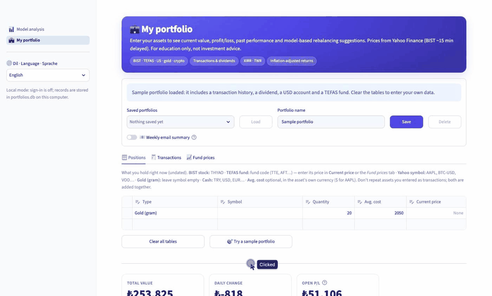
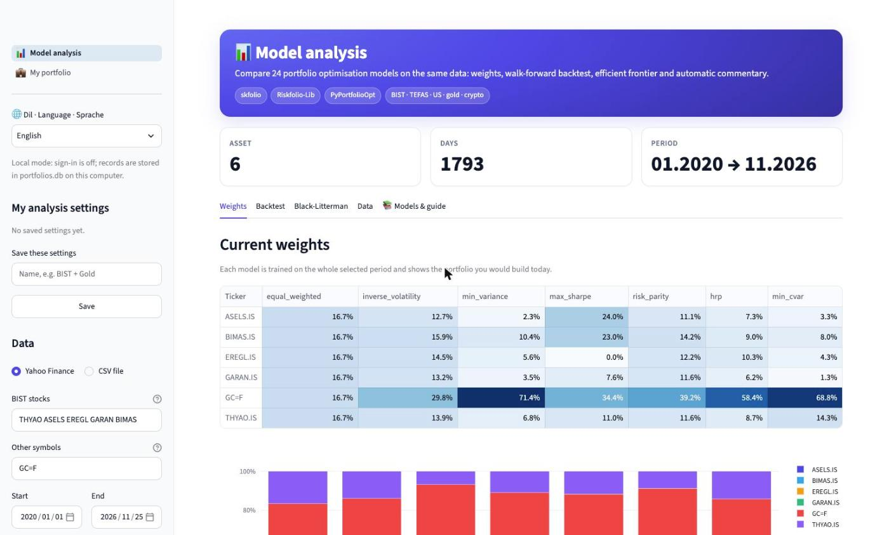
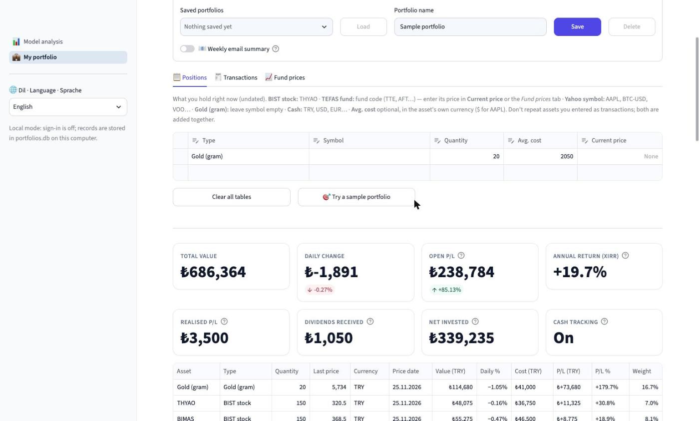
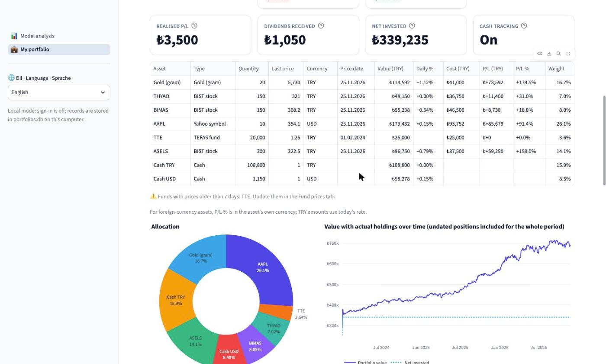
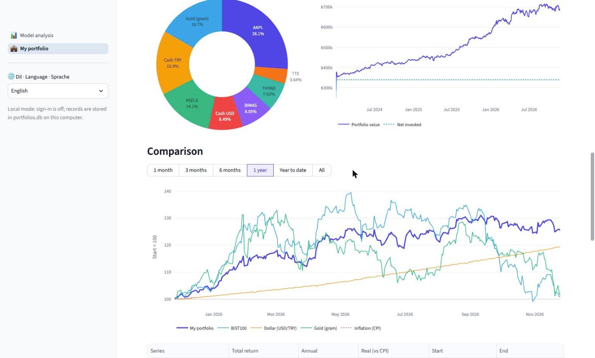

<div align="center">

# 📊 Portfolio-Modelle

**Selbst hostbare Portfolio-Optimierung und -Verfolgung — 24 Modelle, eine Oberfläche.**

Vergleichen Sie Markowitz, Risikoparität, HRP, CVaR, Black-Litterman und mehr mit denselben Daten, testen Sie sie
per Walk-Forward-Backtest, verfolgen Sie Ihr echtes Portfolio mit Transaktionen und Dividenden und lesen Sie zu jedem
Ergebnis einen verständlichen Kommentar.

[](https://portfolio-models.streamlit.app)
[](https://github.com/ozanbayhan/portfolio-models/actions/workflows/ci.yml)
[](https://github.com/ozanbayhan/portfolio-models/pkgs/container/portfolio-models)
[](LICENSE)

[English](README.md) · [Türkçe](README.tr.md) · **Deutsch**

[**Live-Demo ausprobieren →**](https://portfolio-models.streamlit.app?lang=de) &nbsp;·&nbsp; [Dokumentation](https://ozanbayhan.github.io/portfolio-models) &nbsp;·&nbsp; [Selbst hosten](#-selbst-hosten)



</div>

---

## Warum Portfolio-Modelle?

Die meisten Portfolio-Tools liefern **einen** Optimierer und eine Zahl. Portfolio-Modelle stellt **24 etablierte
Modelle nebeneinander** — aufgebaut auf [skfolio](https://github.com/skfolio/skfolio),
[Riskfolio-Lib](https://github.com/dcajasn/Riskfolio-Lib) und [PyPortfolioOpt](https://github.com/PyPortfolio/PyPortfolioOpt) —,
testet sie mit Daten, die sie nie gesehen haben, und **erklärt verständlich**, was jedes Ergebnis bedeutet und wo es
in die Irre führen kann.

Gleichzeitig ist es ein **privater Portfolio-Tracker** für Ihren eigenen Rechner oder Server: Positionen, datierte
Transaktionen, Dividenden, Ein- und Auszahlungen, Cash in mehreren Währungen, geldgewichtete (XIRR) und zeitgewichtete
(TWR) Renditen sowie inflationsbereinigte Vergleiche mit BIST100, US-Dollar und Gold.

## ✨ Funktionen

- 🧮 **24 Optimierungsmodelle** — Gleichgewichtung, Minimum-Varianz, max. Sharpe, CVaR, CDaR, Risikoparität, HRP, HERC, NCO, Schur, Stacking u. v. m.
- 🔁 **Walk-Forward-Backtests** — Ergebnisse nur aus Daten, die das Modell nicht kannte
- 📈 **Effiziente Grenze und Risikobeitrag**
- 🧠 **Automatische Kommentare** — Konzentration, effektive Anzahl von Werten, Risikoquellen, Konsens der Modelle, Overfitting-Warnungen
- 📚 **Modell-Leitfaden** — Geschichte (wer, wann, welches Paper), Grundidee, Leseanleitung, Stärken und Grenzen
- 🎯 **Black-Litterman mit Ihren Einschätzungen**
- 🔒 **Obergrenze je Wert** (z. B. max. 25 %)
- 💼 **Portfolio-Tracker** — Positionen, Käufe/Verkäufe, Dividenden, Ein-/Auszahlungen, Durchschnittskosten, realisierter und offener G/V
- 📥 **Import von Depotauszügen** — erkennt deutsche, englische und türkische Spalten und Begriffe (Kauf, Verkauf, Dividende …)
- 🏦 **TEFAS-Fonds** (türkische Investmentfonds) mit hochgeladener oder manueller Preishistorie
- ⚖️ **Rebalancing-Vorschläge** — exakte Stückzahlen, ganze BIST-Aktien, ohne Cash zu überziehen
- 📊 **Benchmarks und Inflation** — in Lira, US-Dollar oder Euro gegen BIST100, S&P 500, DAX, Gold und den türkischen, US- oder deutschen VPI (TCMB EVDS, FRED/BLS, Bundesbank; OECD als Rückfall); nominale und reale Rendite
- 📧 **Wöchentliche E-Mail-Zusammenfassung** (optional)
- 🌐 **Drei Sprachen** — Deutsch, English, Türkçe
- 👥 **Mehr- oder Einzelbenutzer** — Google-Anmeldung mit getrennten Daten oder Einzelplatzmodus ohne Konfiguration
- 🐳 **Selbst hosten** — `uvx` in einer Zeile, Docker, Docker Compose mit Postgres und E-Mail-Planer

## 🚀 Schnellstart

**Online:** Öffnen Sie die [Live-Demo](https://portfolio-models.streamlit.app?lang=de) und klicken Sie auf der Seite *Mein Portfolio* auf **🎯 Beispielportfolio ausprobieren**.

**Lokal (eine Zeile)** — benötigt [uv](https://docs.astral.sh/uv/getting-started/installation/):

```bash
uvx --from git+https://github.com/ozanbayhan/portfolio-models portfolio-models serve
```

Öffnet <http://localhost:8501> im **lokalen Modus**: keine Anmeldung, ein Benutzer, Daten in `~/.portfolio-models`.
Die Sprache stellen Sie oben in der Seitenleiste um (🌐) — oder direkt mit `?lang=de`.

**Mit Docker:**

```bash
docker run -d --name portfolio-models -p 8501:8501 -v pm-data:/data ghcr.io/ozanbayhan/portfolio-models:latest
```

## 🐳 Selbst hosten

```bash
git clone https://github.com/ozanbayhan/portfolio-models && cd portfolio-models
cp .env.example .env            # optional: alle Einstellungen haben sinnvolle Standardwerte
docker compose up -d            # Einzelbenutzer, SQLite im Volume
```

| Ziel | Befehl / Einstellung |
|---|---|
| Einzelbenutzer ohne Konfiguration | `docker compose up -d` |
| Mehrbenutzer mit Google-Anmeldung | `PM_PUBLIC_URL`, `PM_OAUTH_CLIENT_ID`, `PM_OAUTH_CLIENT_SECRET`, `PM_COOKIE_SECRET` |
| Postgres statt SQLite | `docker compose --profile postgres up -d` und `PM_DATABASE_URL` |
| Wöchentliche E-Mails | `docker compose --profile email up -d` und `SMTP_*` |

👉 Ausführliche Anleitung (Reverse Proxy, Google OAuth, Supabase, Backups, Updates, auf Englisch):
**[docs/self-hosting.md](docs/self-hosting.md)**

## 📸 Screenshots

| Modellanalyse | Portfolio-Tracker |
|---|---|
|  |  |
|  |  |

## 🤝 Mitwirken

Beiträge jeder Größe sind willkommen — Modelle, Übersetzungen, Formate von Depotauszügen, Dokumentation.
Starten Sie mit [CONTRIBUTING.md](CONTRIBUTING.md). Wenn Ihnen das Projekt hilft, **geben Sie ihm einen ⭐**.

## ⚠️ Haftungsausschluss

Nur für Bildung und Forschung. **Keine Anlageberatung.** Vergangene Wertentwicklung ist keine Garantie für die Zukunft.

## Lizenz

[MIT](LICENSE) © Ozan Bayhan
