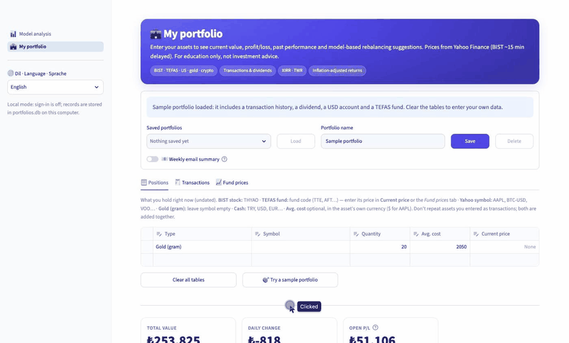
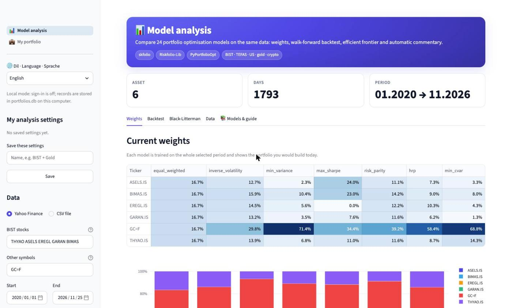
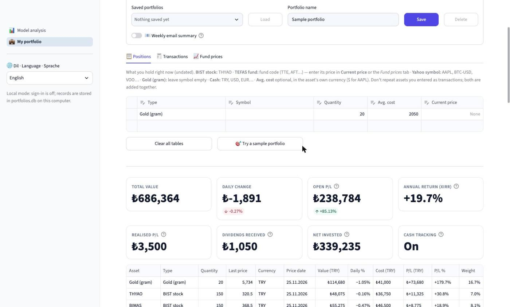
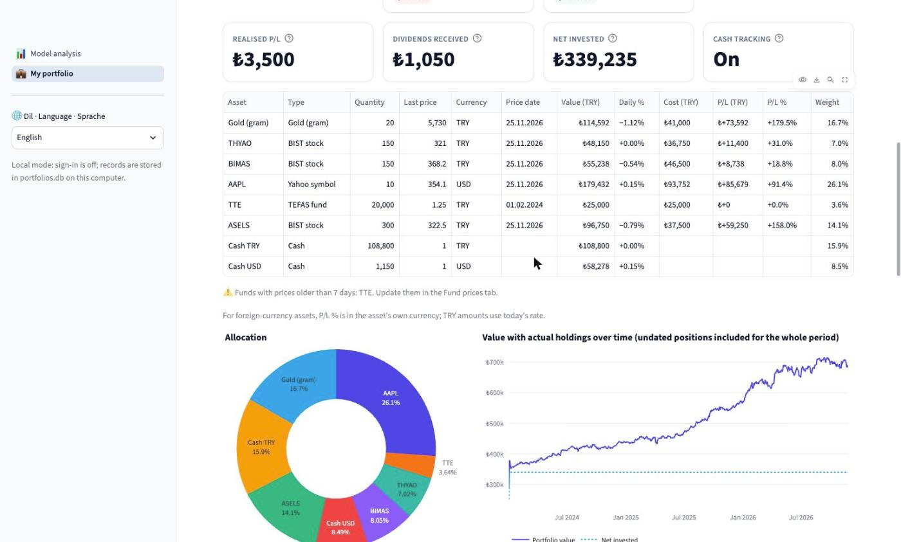
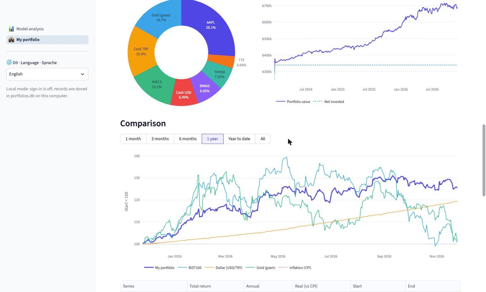
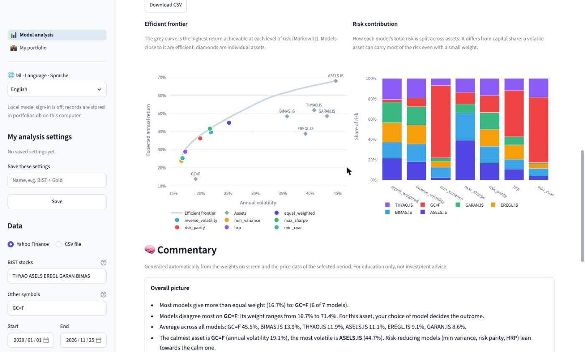

<div align="center">

# 📊 Portfolio Models

**Self-hostable portfolio optimisation & tracking — 24 models, one interface.**

Compare Markowitz, risk parity, HRP, CVaR, Black-Litterman and more on the same data, backtest them walk-forward,
track your real portfolio with transactions and dividends, and read plain-language commentary on every result.

[](https://portfolio-models.streamlit.app)
[](https://github.com/ozanbayhan/portfolio-models/actions/workflows/ci.yml)
[](https://github.com/ozanbayhan/portfolio-models/pkgs/container/portfolio-models)
[](pyproject.toml)
[](LICENSE)
[](https://ozanbayhan.github.io/portfolio-models)

**English** · [Türkçe](README.tr.md) · [Deutsch](README.de.md)

[**Try the live demo →**](https://portfolio-models.streamlit.app) &nbsp;·&nbsp; [Documentation](https://ozanbayhan.github.io/portfolio-models) &nbsp;·&nbsp; [Self-hosting](#-self-hosting)



</div>

---

## Why Portfolio Models?

Most portfolio tools give you **one** optimiser and a number. Portfolio Models puts **24 established models side by
side** — built on the excellent [skfolio](https://github.com/skfolio/skfolio),
[Riskfolio-Lib](https://github.com/dcajasn/Riskfolio-Lib) and [PyPortfolioOpt](https://github.com/PyPortfolio/PyPortfolioOpt) —
tests them on data they have never seen, and **explains in plain language** what each result means and where it can
mislead you.

It is also a **private portfolio tracker** you can run on your own machine or server: positions, dated transactions,
dividends, deposits and withdrawals, multi-currency cash, money-weighted (XIRR) and time-weighted (TWR) returns,
and inflation-adjusted comparisons against BIST100, USD and gold.

## ✨ Features

| | |
|---|---|
| 🧮 **24 optimisation models** | Equal weight, inverse volatility, min variance, max Sharpe (classic & shrunk), max Sortino, min CVaR / CDaR / max drawdown, max diversification, distributionally robust CVaR, risk parity (variance & CVaR), HRP, HERC, NCO, Schur, stacking, plus Riskfolio-Lib & PyPortfolioOpt variants |
| 🔁 **Walk-forward backtests** | Train on a rolling window, hold, roll forward — results only from data the model could not see |
| 📈 **Efficient frontier & risk contribution** | See where every model sits relative to the Markowitz frontier and which asset really drives risk |
| 🧠 **Automatic commentary** | Rule-based, data-driven explanations: concentration, effective number of assets, risk sources, consensus between models, overfitting warnings |
| 📚 **Model guide** | History (who, when, paper), core idea, how to read the results, strengths and cautions for every model, plus a metrics glossary |
| 🎯 **Black-Litterman with your views** | Enter absolute or relative views and see exactly how they move the weights |
| 🔒 **Weight limits** | Cap any single asset (e.g. max 25%) across all models that support constraints |
| 💼 **Portfolio tracker** | Positions, dated buy/sell, dividends, deposits/withdrawals, average cost, realised & open P/L |
| 📥 **Broker statement import** | CSV/Excel import that recognises Turkish, English and German column names and values; duplicate-safe |
| 🏦 **TEFAS funds** | Upload price history from TEFAS exports or type it in; funds join charts and rebalancing |
| ⚖️ **Rebalancing suggestions** | Exact buy/sell quantities to reach any model's target, whole shares for BIST, never overdrawing cash |
| 📊 **Benchmarks & inflation** | Compare against BIST100, USD/TRY, gold and CPI (TCMB EVDS or OECD) — nominal and real returns |
| 📧 **Weekly email summary** | Opt-in Monday digest of value, weekly change and stale fund prices |
| 🌐 **Three languages** | Türkçe, English, Deutsch — UI, commentary, model guide and emails |
| 👥 **Multi-user or single-user** | Google sign-in with per-user isolation, or zero-config local mode |
| 🐳 **Self-hosting** | One-line `uvx`, Docker image, Docker Compose with Postgres and email scheduler |

## 🚀 Quick start

### 1. Try it online
Open the **[live demo](https://portfolio-models.streamlit.app)** — no sign-up needed. Click **🎯 Try a sample portfolio** on
the *My portfolio* page to see every feature with example data.

### 2. Run it on your computer (one line)
Requires [uv](https://docs.astral.sh/uv/getting-started/installation/).

```bash
uvx --from git+https://github.com/ozanbayhan/portfolio-models portfolio-models serve
```

Opens on <http://localhost:8501>. Runs in **local mode**: no sign-in, a single user, data stored in `~/.portfolio-models`.

### 3. Run it with Docker

```bash
docker run -d --name portfolio-models -p 8501:8501 -v pm-data:/data ghcr.io/ozanbayhan/portfolio-models:latest
```

## 🐳 Self-hosting

```bash
git clone https://github.com/ozanbayhan/portfolio-models && cd portfolio-models
cp .env.example .env            # optional: every setting has a sensible default
docker compose up -d            # single user, SQLite in a volume
```

| Goal | Command / setting |
|---|---|
| Single user, zero config | `docker compose up -d` |
| Many users with Google sign-in | set `PM_PUBLIC_URL`, `PM_OAUTH_CLIENT_ID`, `PM_OAUTH_CLIENT_SECRET`, `PM_COOKIE_SECRET` |
| Postgres instead of SQLite | `docker compose --profile postgres up -d` and set `PM_DATABASE_URL` |
| Weekly email summaries | `docker compose --profile email up -d` and set `SMTP_*` |
| Up-to-date Turkish CPI | `PM_EVDS_API_KEY` (free key from TCMB EVDS) |

👉 Full guide — reverse proxy (Caddy/Nginx), Google OAuth step by step, Supabase, backups, upgrades:
**[docs/self-hosting.md](docs/self-hosting.md)**

## 📸 Screenshots

| Model analysis | Portfolio tracker |
|---|---|
|  |  |
| **Holdings, allocation & value over time** | **Benchmarks & inflation** |
|  |  |
| **Efficient frontier, risk contribution & commentary** | |
|  | |

## 🧮 Models

| Model | Idea | Origin |
|---|---|---|
| `equal_weighted` | 1/N — the benchmark every model must beat | DeMiguel, Garlappi & Uppal (2009) |
| `inverse_volatility` | Weight ∝ 1/volatility | Practitioner rule |
| `min_variance` | Lowest total volatility | Markowitz (1952) |
| `max_sharpe` · `max_sharpe_shrunk` | Highest return per unit of risk | Tobin (1958), Sharpe (1966), Ledoit & Wolf (2004) |
| `max_sortino` | Highest return per unit of downside risk | Sortino & van der Meer (1991) |
| `min_cvar` | Smallest average loss on the worst 5% of days | Rockafellar & Uryasev (2000) |
| `min_cdar` · `min_max_drawdown` | Smallest drawdowns | Chekhlov, Uryasev & Zabarankin (2003) |
| `max_diversification` | Highest diversification ratio | Choueifaty & Coignard (2008) |
| `dro_cvar` | CVaR robust to distribution shifts (Wasserstein) | Esfahani & Kuhn (2018) |
| `risk_parity` · `risk_parity_cvar` | Equal risk contribution | Qian (2005), Maillard, Roncalli & Teïletche (2010) |
| `hrp` · `hrp_cdar` | Hierarchical risk parity | López de Prado (2016) |
| `herc` | Hierarchical equal risk contribution | Raffinot (2017) |
| `nco` | Nested clustered optimisation | López de Prado (2019) |
| `schur` | Schur complementary allocation | Cotton (2024) |
| `stacking` | Ensemble of several models | Wolpert (1992) |
| `riskfolio_*` · `pypfopt_*` | The same ideas from Riskfolio-Lib and PyPortfolioOpt, for cross-checking | — |

Every model has a full entry in the in-app **📚 Models & guide** tab and in the [model guide](docs/models.md).

## 🧑‍💻 Use it as a Python library or CLI

```bash
uv add git+https://github.com/ozanbayhan/portfolio-models
portfolio-models list                                    # all models
portfolio-models weights  --bist THYAO ASELS --tickers GC=F AAPL
portfolio-models backtest --bist THYAO ASELS --tickers GC=F --start 2020-01-01
```

```python
from portfolio_models import bist, load_prices, to_returns, fit_weights, backtest, summarize

returns = to_returns(load_prices(bist("THYAO", "ASELS") + ["GC=F", "AAPL"], start="2020-01-01"))
print(fit_weights(returns, ["hrp", "risk_parity", "max_sharpe"], max_weight=0.4))
print(summarize(backtest(returns, ["equal_weighted", "hrp", "risk_parity"])))
```

## 🏗️ Architecture

```
src/portfolio_models/
├── models.py, adapters.py        24 models behind one scikit-learn-style interface
├── backtest.py, charts.py        walk-forward backtests, efficient frontier, risk contribution
├── holdings.py                   positions, transactions, cash, valuation, rebalancing, XIRR
├── benchmarks.py                 TWR, BIST100/USD/gold, CPI (TCMB EVDS / OECD)
├── insights.py, model_guide.py   commentary and model guide
├── i18n.py, locales.py           Türkçe / English / Deutsch
├── store.py, report.py           per-user storage (SQLite/Postgres), weekly email
└── web/                          Streamlit UI (app.py, holdings_page.py, ui.py)
```

Data stays where you run it. Prices come from Yahoo Finance; inflation from TCMB EVDS or OECD.

## 🗺️ Roadmap

See [ROADMAP.md](ROADMAP.md). Highlights: per-asset min/max and sector constraints, transaction costs in backtests,
PDF reports, price alerts, broker-specific import presets, more languages. Ideas welcome in
[Discussions](https://github.com/ozanbayhan/portfolio-models/discussions).

## 🤝 Contributing

Contributions of all sizes are welcome — models, translations, broker import formats, docs. Start with
[CONTRIBUTING.md](CONTRIBUTING.md) and look for issues labelled
[`good first issue`](https://github.com/ozanbayhan/portfolio-models/issues?q=is%3Aissue+is%3Aopen+label%3A%22good+first+issue%22).

If this project is useful to you, **please give it a ⭐** — it helps others find it.

## ⚠️ Disclaimer

For education and research only. **Not investment advice.** Past performance does not guarantee future results.

## License

[MIT](LICENSE) © Ozan Bayhan. Built on [skfolio](https://github.com/skfolio/skfolio),
[Riskfolio-Lib](https://github.com/dcajasn/Riskfolio-Lib), [PyPortfolioOpt](https://github.com/PyPortfolio/PyPortfolioOpt)
and [Streamlit](https://streamlit.io).
