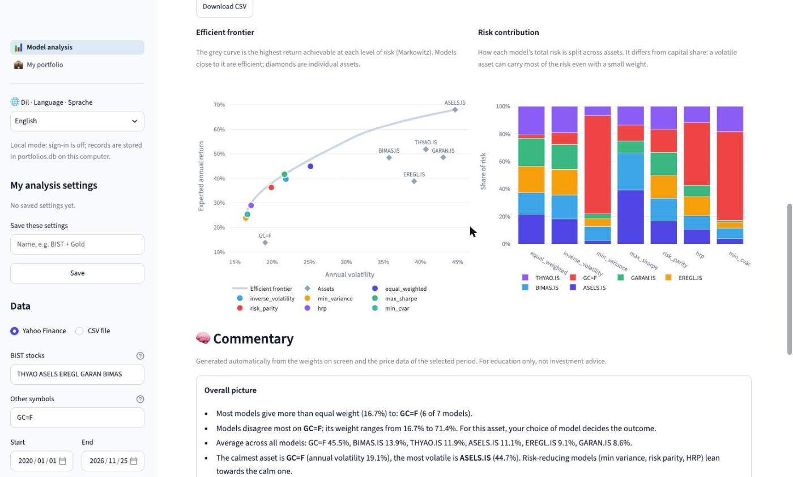
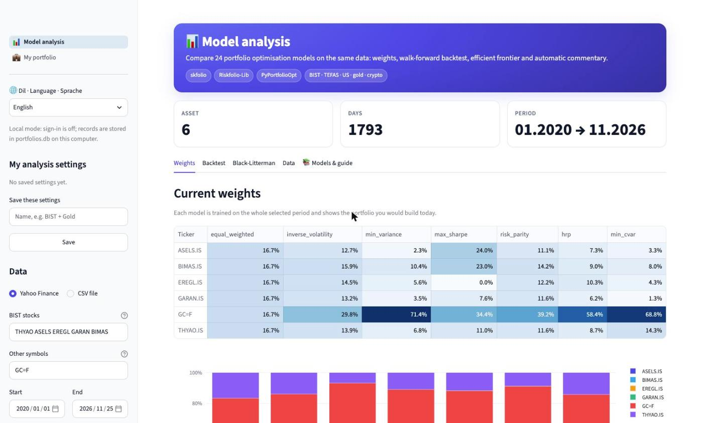
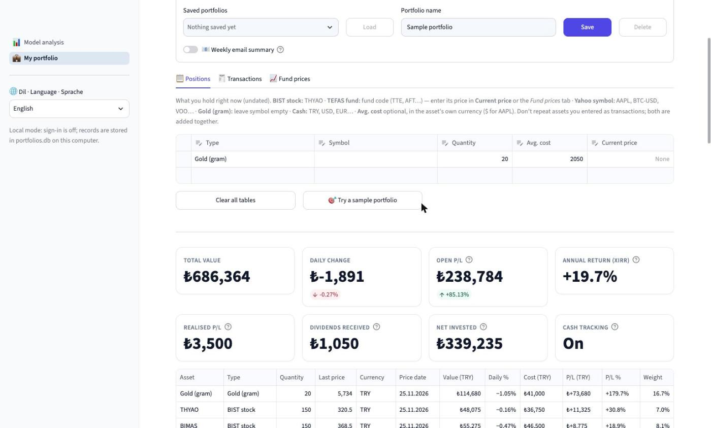
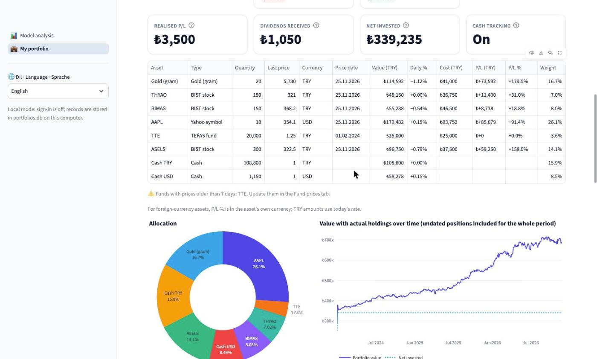
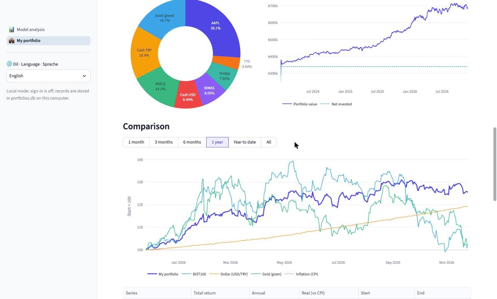

<div align="center">

# 📊 Portföy Modelleri

**Kendi sunucunuza kurabileceğiniz portföy optimizasyonu ve takip aracı — 24 model, tek arayüz.**

Markowitz, risk paritesi, HRP, CVaR, Black-Litterman ve daha fazlasını aynı veriyle karşılaştırın, walk-forward
backtest yapın, gerçek portföyünüzü işlem ve temettüleriyle takip edin; her sonucun ne anlama geldiğini sade Türkçe okuyun.

[](https://portfolio-models.streamlit.app)
[](https://github.com/ozanbayhan/portfolio-models/actions/workflows/ci.yml)
[](https://github.com/ozanbayhan/portfolio-models/pkgs/container/portfolio-models)
[](LICENSE)

[English](README.md) · **Türkçe** · [Deutsch](README.de.md)

[**Canlı demoyu deneyin →**](https://portfolio-models.streamlit.app) &nbsp;·&nbsp; [Dokümantasyon](https://ozanbayhan.github.io/portfolio-models) &nbsp;·&nbsp; [Kendi sunucunuza kurun](#-kendi-sunucunuza-kurun)



</div>

---

## Neden Portföy Modelleri?

Çoğu portföy aracı size **tek** bir optimizasyon ve bir sayı verir. Portföy Modelleri, [skfolio](https://github.com/skfolio/skfolio),
[Riskfolio-Lib](https://github.com/dcajasn/Riskfolio-Lib) ve [PyPortfolioOpt](https://github.com/PyPortfolio/PyPortfolioOpt)
üzerine kurulu **24 yerleşik modeli yan yana** koyar, onları hiç görmedikleri veride sınar ve her sonucun ne anlama
geldiğini, nerede yanıltabileceğini **sade bir dille açıklar**.

Aynı zamanda kendi bilgisayarınızda ya da sunucunuzda çalıştırabileceğiniz **özel bir portföy takip aracıdır**:
pozisyonlar, tarihli işlemler, temettüler, para yatırma/çekme, çok dövizli nakit, para ağırlıklı (XIRR) ve zaman
ağırlıklı (TWR) getiri, BIST100, dolar ve altına karşı enflasyondan arındırılmış karşılaştırmalar.

## ✨ Özellikler

- 🧮 **24 optimizasyon modeli** — eşit ağırlık, min. varyans, maks. Sharpe, CVaR, CDaR, risk paritesi, HRP, HERC, NCO, Schur, stacking ve daha fazlası
- 🔁 **Walk-forward backtest** — sonuçlar yalnızca modelin o an göremediği veriden
- 📈 **Etkin sınır ve risk katkısı** grafikleri
- 🧠 **Otomatik yorumlar** — yoğunlaşma, etkin varlık sayısı, risk kaynağı, modellerin ortak görüşü, aşırı uyum uyarıları
- 📚 **Model rehberi** — her modelin tarihçesi (kim, ne zaman, hangi makale), temel fikri, sonuçlarının nasıl okunacağı
- 🎯 **Kendi görüşlerinizle Black-Litterman**
- 🔒 **Tek varlık üst sınırı** (ör. en fazla %25)
- 💼 **Portföy takibi** — pozisyonlar, alım/satım, temettü, para yatırma/çekme, ortalama maliyet, gerçekleşen ve açık K/Z
- 📥 **Aracı kurum ekstresi içe aktarma** — Türkçe, İngilizce ve Almanca sütun adlarını tanır, tekrarları atlar
- 🏦 **TEFAS fonları** — TEFAS'tan indirilen CSV/Excel ya da elle girilen fiyat geçmişi
- ⚖️ **Yeniden dengeleme önerisi** — adet adet alım/satım, BIST için tam adet, nakdi eksiye düşürmeden
- 📊 **Benchmark ve enflasyon** — BIST100, dolar, gram altın, TÜFE (TCMB EVDS ya da OECD); nominal ve reel getiri
- 📧 **Haftalık e-posta özeti** (isteğe bağlı)
- 🌐 **Üç dil** — Türkçe, English, Deutsch
- 👥 **Çok ya da tek kullanıcı** — Google ile giriş ve kullanıcıya özel kayıt, ya da ayarsız yerel mod
- 🐳 **Kendi sunucunuza kurulum** — tek satır `uvx`, Docker, Postgres ve e-posta zamanlayıcılı Docker Compose

## 🚀 Hızlı başlangıç

**Çevrimiçi:** [Canlı demoyu](https://portfolio-models.streamlit.app) açın; *Portföyüm* sayfasında **🎯 Örnek portföyle dene** düğmesine basın.

**Bilgisayarınızda (tek satır)** — [uv](https://docs.astral.sh/uv/getting-started/installation/) gerekir:

```bash
uvx --from git+https://github.com/ozanbayhan/portfolio-models portfolio-models serve
```

<http://localhost:8501> adresinde açılır. **Yerel mod**: giriş yok, tek kullanıcı, veriler `~/.portfolio-models` klasöründe.

**Docker ile:**

```bash
docker run -d --name portfolio-models -p 8501:8501 -v pm-data:/data ghcr.io/ozanbayhan/portfolio-models:latest
```

## 🐳 Kendi sunucunuza kurun

```bash
git clone https://github.com/ozanbayhan/portfolio-models && cd portfolio-models
cp .env.example .env            # isteğe bağlı: tüm ayarların makul varsayılanı var
docker compose up -d            # tek kullanıcı, SQLite (volume içinde)
```

| Amaç | Komut / ayar |
|---|---|
| Tek kullanıcı, ayarsız | `docker compose up -d` |
| Google girişli çok kullanıcı | `PM_PUBLIC_URL`, `PM_OAUTH_CLIENT_ID`, `PM_OAUTH_CLIENT_SECRET`, `PM_COOKIE_SECRET` |
| SQLite yerine Postgres | `docker compose --profile postgres up -d` ve `PM_DATABASE_URL` |
| Haftalık e-posta | `docker compose --profile email up -d` ve `SMTP_*` |
| Güncel TÜFE | `PM_EVDS_API_KEY` (TCMB EVDS'den ücretsiz anahtar) |

👉 Ayrıntılı rehber (ters vekil sunucu, Google OAuth adım adım, Supabase, yedekleme, güncelleme):
**[docs/self-hosting.md](docs/self-hosting.md)**

## 📸 Ekran görüntüleri

| Model analizi | Portföy takibi |
|---|---|
|  |  |
|  |  |

## 🧑‍💻 Python kütüphanesi ve komut satırı

```bash
portfolio-models list
portfolio-models weights  --bist THYAO ASELS --tickers GC=F AAPL
portfolio-models backtest --bist THYAO ASELS --tickers GC=F --start 2020-01-01
```

```python
from portfolio_models import bist, load_prices, to_returns, fit_weights
returns = to_returns(load_prices(bist("THYAO", "ASELS") + ["GC=F"], start="2020-01-01"))
print(fit_weights(returns, ["hrp", "risk_parity", "max_sharpe"], max_weight=0.4))
```

## 🤝 Katkı

Her boyutta katkıya açığız: yeni modeller, çeviriler, aracı kurum ekstre biçimleri, dokümantasyon.
[CONTRIBUTING.md](CONTRIBUTING.md) ile başlayın. Proje işinize yaradıysa **⭐ vererek** başkalarının da bulmasına yardımcı olun.

## ⚠️ Uyarı

Eğitim ve araştırma amaçlıdır. **Yatırım tavsiyesi değildir.** Geçmiş performans gelecekteki sonuçları garanti etmez.

## Lisans

[MIT](LICENSE) © Ozan Bayhan
