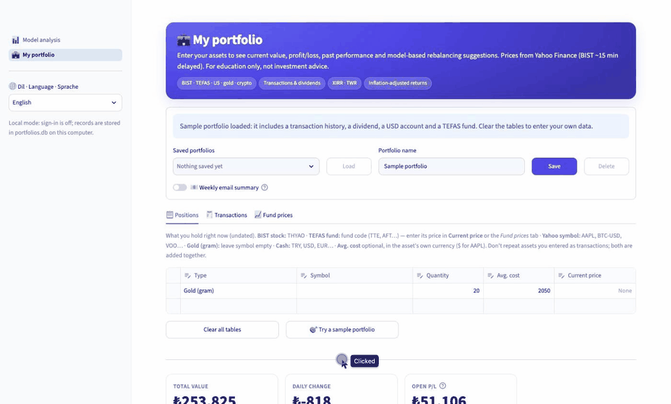

# Portfolio Models

**Self-hostable portfolio optimisation & tracking — 24 models, one interface.**

Compare Markowitz, risk parity, HRP, CVaR, Black-Litterman and more on the same data, backtest them walk-forward,
track your real portfolio with transactions and dividends, and read plain-language commentary on every result —
in English, Türkçe or Deutsch.

[Try the live demo](https://portfolio-models.streamlit.app){ .md-button .md-button--primary }
[Install it](getting-started.md){ .md-button }
[GitHub](https://github.com/ozanbayhan/portfolio-models){ .md-button }

## What you can do

- **Analyse** — pick any mix of BIST stocks, Yahoo Finance symbols, gold, FX or your own CSV and see the weights
  of 24 models side by side, with an efficient frontier, risk contribution and automatic commentary.
- **Backtest** — walk-forward tests show how each model would have done on data it had not seen.
- **Track** — enter positions or dated transactions (buys, sells, dividends, deposits, withdrawals), import broker
  statements, add TEFAS fund prices and follow value, P/L, XIRR and TWR over time.
- **Compare** — your portfolio against BIST100, USD/TRY, gold and inflation, nominal and real.
- **Rebalance** — exact buy/sell quantities to reach any model's target weights.
- **Learn** — every model has a guide: who invented it, when, the core idea, how to read it and where it misleads.

## Where to go next

| I want to… | Read |
|---|---|
| run it on my computer in one minute | [Getting started](getting-started.md) |
| host it for my family or team | [Self-hosting](self-hosting.md) |
| learn the app screen by screen | [User guide](user-guide.md) |
| understand a model | [Model guide](models.md) |
| understand a number | [Metrics glossary](metrics.md) |
| use it from Python or the terminal | [Library & CLI](library.md) |
| contribute | [Architecture](architecture.md) · [Contributing](https://github.com/ozanbayhan/portfolio-models/blob/main/CONTRIBUTING.md) |

!!! warning "Not investment advice"
    Portfolio Models is for education and research. Past performance does not guarantee future results.
